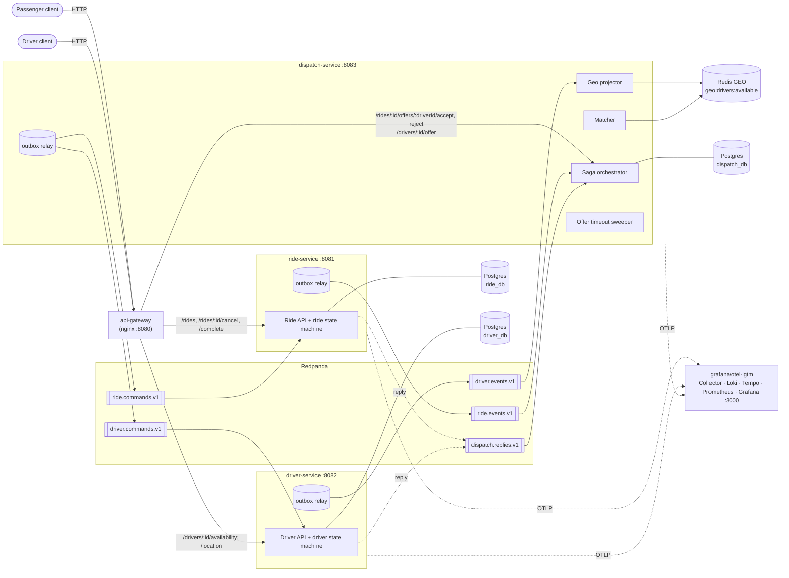
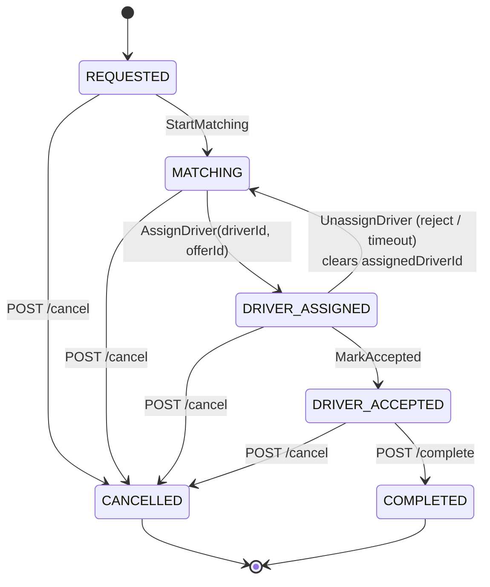
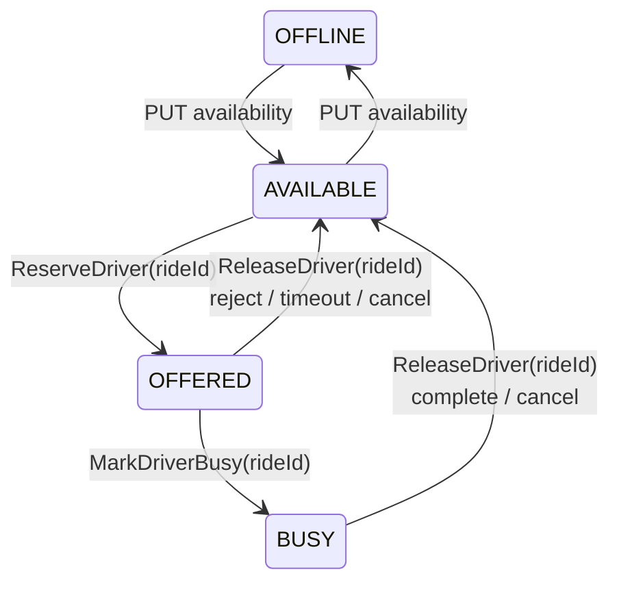
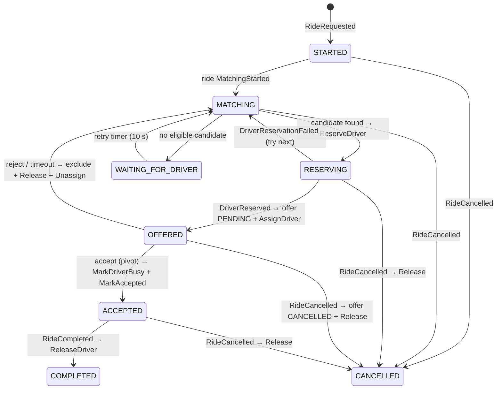

# Architecture — Ride-Hailing Dispatch Service

Three Go microservices coordinate one **orchestrated saga** per ride over **Redpanda**. Each service owns its **PostgreSQL** database. **Redis GEO** is a fast, disposable index for finding nearby drivers. PostgreSQL always decides who gets a driver.

Related: [requirements](requirements.md) · [sequence diagrams](sequence-diagram.md) · [scalability](scalability.md) · [observability](observability.md) · [local development](local-development.md) · ADRs [001 matching](adr/ADR-001-matching.md), [002 concurrency](adr/ADR-002-concurrency.md), [003 saga](adr/ADR-003-saga-orchestration.md), [004 messaging](adr/ADR-004-messaging-outbox-inbox.md), [005 observability](adr/ADR-005-observability.md)

---

## 1. System diagram



### Why each part is there

| Component | Job | Requirement or number it serves |
|---|---|---|
| **api-gateway** (nginx) | One public port; routes by path to the owning service | Spec endpoints (`/rides/...`) span two services |
| **ride-service** | Owns `Ride`, `Passenger`, idempotency keys, the **ride state machine** | AC-01, AC-06, AC-08 |
| **driver-service** | Owns `Driver` status + location, the **driver state machine**, the atomic reservation | AC-02, AC-03, AC-09 |
| **dispatch-service** | Owns `RideOffer`, exclusions, the **saga**, matching, offer timeouts | AC-04, AC-05, AC-07, AC-10 |
| **PostgreSQL** (one container, 3 databases, 3 users) | Source of truth, transactions, conditional updates, outbox/inbox | AC-06 "persisted", AC-09 "database-based approach" |
| **Redis GEO** | Nearest-driver index: `GEOSEARCH … BYRADIUS ASC` is O(N+log M) | AC-04; at 1M drivers a SQL scan is too slow ([scalability](scalability.md)) |
| **Redpanda** | Kafka-compatible log for events, commands and replies. Single binary with no ZooKeeper/JVM, so it is light on a laptop | AC-10, T5 |
| **otel-lgtm** | All-in-one OTel Collector + Loki + Tempo + Prometheus + Grafana in one container | Observability, T3 |

> **Why not a modular monolith?** The challenge allows one, and it would be simpler. The team chose microservices (T1). The cost is eventual consistency between services and more moving parts. We limit it to **three** services split along the three aggregates that have different change rates and scaling needs: rides (low write rate), drivers (very high location write rate), dispatch (CPU and coordination). See trade-offs in §7.

---

## 2. Service boundaries & data ownership

| Service | Owns (writes) | Reads from others via | Never does |
|---|---|---|---|
| ride-service | `passengers`, `rides`, `ride_transitions`, `idempotency_keys` | — | Touch driver status |
| driver-service | `drivers` (status, location, `current_ride_id`, `version`) | — | Decide which ride a driver gets |
| dispatch-service | `dispatch_sagas`, `offers`, `ride_exclusions`, `saga_steps`, Redis GEO projection | Events (`ride.events`, `driver.events`) | Write rides or drivers directly; it **sends commands** |

Every database also has `outbox` and `inbox` tables ([ADR-004](adr/ADR-004-messaging-outbox-inbox.md)).

---

## 3. API (through the gateway, `:8080`)

Errors use `application/problem+json` (RFC 9457) with a stable `code`.

| Method & path | Service | Success | Notable errors |
|---|---|---|---|
| `POST /rides` + `Idempotency-Key` | ride | `201` ride (`REQUESTED`). Replay of the same key + same body returns `201` with the original body and `Idempotent-Replayed: true` | `400 IDEMPOTENCY_KEY_REQUIRED`, `422 INVALID_COORDINATES`, `422 UNKNOWN_PASSENGER`, `422 IDEMPOTENCY_KEY_REUSED` (same key, different body) |
| `GET /rides/{rideId}` | ride | `200` ride | `404` |
| `POST /rides/{rideId}/cancel` | ride | `200` ride (`CANCELLED`); repeat gives `200` | `409 INVALID_TRANSITION` (e.g. from `COMPLETED`) |
| `POST /rides/{rideId}/complete` | ride | `200` ride (`COMPLETED`); repeat gives `200` | `409 INVALID_TRANSITION` |
| `POST /rides/{rideId}/offers/{driverId}/accept` | dispatch | `200 {offerId, status:"ACCEPTED"}`; repeat gives `200` | `404 OFFER_NOT_FOUND`, `409 OFFER_NOT_CURRENT`, `409 OFFER_EXPIRED` |
| `POST /rides/{rideId}/offers/{driverId}/reject` | dispatch | `200 {status:"REJECTED"}`; repeat gives `200` | same as accept |
| `GET /rides/{rideId}/dispatch` | dispatch | `200` saga state + all offers (debug view) | `404` |
| `GET /drivers/{driverId}/offer` | dispatch | `200` current pending offer or `204` | — |
| `PUT /drivers/{driverId}/availability` `{"status":"AVAILABLE"\|"OFFLINE"}` | driver | `200` driver | `409 INVALID_TRANSITION` (driver is `OFFERED`/`BUSY`) |
| `PUT /drivers/{driverId}/location` `{"latitude":..,"longitude":..}` | driver | `200` driver | `422 INVALID_COORDINATES` |
| `GET /drivers/{driverId}` | driver | `200` driver | `404` |

**Accept/reject are synchronous on the offer, asynchronous on the ride.** The `200` means the offer row in `dispatch_db` changed (this is the decision point). The ride shows `DRIVER_ACCEPTED` and the driver shows `BUSY` a few milliseconds later, once the saga's commands are processed. Tests poll `GET /rides/{id}` with a short timeout.

---

## 4. State machines

### Ride (ride-service) — `internal/ride/statemachine.go`



`Transition(ride, cmd) (changed bool, err error)` is a pure function over a table:

* **Valid** → new state, `changed = true`. Persisted with `UPDATE rides … WHERE id = $1 AND version = $2` (optimistic lock) together with a `ride_transitions` audit row and an outbox event, all in one transaction.
* **Duplicate**: the ride is already in the target state with the same data (e.g. `AssignDriver(D1, O7)` when already `DRIVER_ASSIGNED` with D1/O7). Result is `changed = false`, no error, no new event. This keeps the operation idempotent.
* **Invalid** (e.g. `COMPLETED → DRIVER_ASSIGNED`) → `ErrInvalidTransition`, HTTP `409` or command reply `Rejected`.

### Driver (driver-service) — `internal/driver/statemachine.go`



Every saga command carries `rideId`. Commands apply only when `current_ride_id = rideId`. A late or duplicate `ReleaseDriver(R1)` therefore can never free a driver who has already moved on to ride R2.

### Dispatch saga (dispatch-service)



---

## 5. The dispatch saga

**Orchestration, not choreography** ([ADR-003](adr/ADR-003-saga-orchestration.md)). The dispatch flow has a loop (rematch), a timer (offer timeout) and compensations. Keeping it in one state machine (`dispatch_sagas`) makes it testable and makes "what happened to R001" a single row plus its `saga_steps`.

| # | Step | Participant | Type | Compensation |
|---|---|---|---|---|
| 1 | `StartMatching` → ride `MATCHING` | ride-service | compensatable | (cancel handles it) |
| 2 | Pick nearest eligible candidate from Redis GEO | dispatch (local) | read-only | — |
| 3 | `ReserveDriver` → driver `AVAILABLE→OFFERED` (atomic) | driver-service | compensatable | `ReleaseDriver` |
| 4 | Create offer `PENDING` (expires in 30 s) + `AssignDriver` → ride `DRIVER_ASSIGNED` | dispatch + ride-service | compensatable | offer `REJECTED/EXPIRED/CANCELLED` + `UnassignDriver` |
| 5 | **Driver accepts → offer `ACCEPTED`** | dispatch | **pivot** | none; after this the saga only moves forward |
| 6 | `MarkDriverBusy` + `MarkAccepted` | driver + ride | retriable (idempotent, retried until success) | — |
| 7 | Ride `COMPLETED`/`CANCELLED` → `ReleaseDriver` | driver-service | retriable | — |

Message flow details and all race scenarios are drawn in [sequence-diagram.md](sequence-diagram.md).

### Topics (Redpanda)

| Topic | Key | Producer → consumer | Messages |
|---|---|---|---|
| `ride.events.v1` | `rideId` | ride → dispatch | `RideRequested`, `RideCancelled`, `RideCompleted` (+ informational `RideStatusChanged`) |
| `driver.events.v1` | `driverId` | driver → dispatch (geo projector) | `DriverStatusChanged`, `DriverLocationUpdated` (carry `version`) |
| `ride.commands.v1` | `rideId` | dispatch → ride | `StartMatching`, `AssignDriver`, `UnassignDriver`, `MarkAccepted` |
| `driver.commands.v1` | `driverId` | dispatch → driver | `ReserveDriver`, `ReleaseDriver`, `MarkDriverBusy` |
| `dispatch.replies.v1` | `rideId` | ride, driver → dispatch | `CommandSucceeded`, `CommandRejected`, `DriverReserved`, `DriverReservationFailed` |
| `*.dlq` | same | any | Poison messages after 5 attempts |

Keying by `rideId` or `driverId` keeps messages about one aggregate in order. For example, `AssignDriver` always reaches ride-service before the `MarkAccepted` for the same ride.

### Message envelope

```json
{
  "eventId": "0192f3c4-…",           // UUIDv7, unique per message — dedup key
  "type": "ReserveDriver",
  "schemaVersion": 1,
  "occurredAt": "2026-11-01T07:12:03.120Z",
  "correlationId": "<rideId>",        // always the ride
  "causationId": "<eventId that caused this>",
  "rideId": "…", "driverId": "D003", "offerId": "…",
  "payload": { }
}
```

The Kafka header `traceparent` carries the W3C trace context, so one trace spans HTTP → outbox → Redpanda → consumer → outbox → …

---

## 6. Data model

```sql
-- ride_db
passengers(id text PK, name text)
rides(id uuid PK, passenger_id text FK, pickup_lat, pickup_lng, dest_lat, dest_lng numeric,
      status text CHECK (...), assigned_driver_id text NULL, current_offer_id uuid NULL,
      version bigint, created_at, updated_at)
ride_transitions(id bigserial, ride_id, from_status, to_status, driver_id, cause_event_id, at)
idempotency_keys(key text PK, request_hash bytea, ride_id uuid, status_code int,
                 response jsonb, created_at)               -- TTL 24h via cleanup job

-- driver_db
drivers(id text PK, status text CHECK (...), lat, lng numeric, current_ride_id uuid NULL,
        version bigint, location_updated_at, updated_at)

-- dispatch_db
dispatch_sagas(ride_id uuid PK, status text, pickup_lat, pickup_lng, radius_m int,
               reserving_driver_id text, current_offer_id uuid, round int,
               round_skips text[],      -- drivers that failed reservation this round
               next_retry_at timestamptz, version bigint, updated_at)
offers(id uuid PK, ride_id uuid, driver_id text, status text, -- PENDING|ACCEPTED|REJECTED|EXPIRED|CANCELLED
       created_at, expires_at, responded_at)
  UNIQUE (driver_id) WHERE status = 'PENDING'   -- a driver holds ≤ 1 pending offer
  UNIQUE (ride_id)   WHERE status = 'PENDING'   -- a ride has ≤ 1 pending offer
  INDEX  (expires_at) WHERE status = 'PENDING'  -- timeout sweeper
ride_exclusions(ride_id uuid, driver_id text, reason text, at, PRIMARY KEY (ride_id, driver_id))
saga_steps(id bigserial, ride_id, step text, outcome text, event_id uuid, driver_id, detail jsonb, at)

-- every database
outbox(id bigserial PK, topic, msg_key, event_id uuid UNIQUE, type, payload jsonb,
       headers jsonb, created_at, published_at NULL)
inbox(consumer text, event_id uuid, processed_at, PRIMARY KEY (consumer, event_id))
```

### Redis keys (owned by dispatch-service, rebuildable)

| Key | Type | Content |
|---|---|---|
| `geo:drivers:available` | GEO (sorted set) | Only `AVAILABLE` drivers: `GEOADD lng lat driverId` / `ZREM` |
| `driver:{id}` | HASH | `status, lat, lng, version` for exact distance and out-of-order protection |

The projector applies each driver event with a Lua script: *if event.version > stored version then update hash and GEOADD/ZREM*. Old or duplicate events are ignored. If Redis is lost, `make rebuild-geo` replays from driver-service (`GET /internal/drivers?status=AVAILABLE`).

---

## 7. Key decisions & trade-offs

| Decision | Solves | Worsens | Change it when |
|---|---|---|---|
| 3 microservices (not a monolith) | Independent scaling of the location-heavy driver path; clear ownership; matches T1 | Eventual consistency between ride/driver/offer; more infra; harder local debugging | Team is small and scale stays < 10k drivers. Then fold into a modular monolith with the same module boundaries |
| Orchestrated saga in dispatch | One place holds the dispatch logic, loop and timers; easy to test and trace | dispatch-service is a central dependency; more round-trips than choreography | Flow becomes simple and linear, or orchestrator throughput becomes a bottleneck (then partition by city) |
| Conditional `UPDATE … WHERE status='AVAILABLE'` on driver row as the lock | Correct under any concurrency without distributed locks; survives crashes | Hot drivers create contention and retries; one Postgres primary for all drivers | Reservation rate > ~5k/s per city. Then shard drivers by city, or batch matching |
| Redis GEO as a projection (eventually consistent) | Fast nearest search; dispatch does not call driver-service synchronously | Stale candidates mean wasted reservations; one more thing to rebuild | Staleness causes many failed reservations. Then read Redis written synchronously by driver-service |
| Outbox + inbox + at-least-once | No lost or phantom events when a service crashes between DB commit and publish | Write amplification (each change = 2 rows); relay adds ~10–50 ms | Throughput needs CDC (Debezium) instead of polling |
| Offer timeout via Postgres sweeper (`FOR UPDATE SKIP LOCKED`, every 1 s) | Durable, simple, safe with multiple dispatch replicas | Up to 1 s late; polling load | Offer volume > ~1k/s. Then use a Redis ZSET delay queue or a durable timer service |
| Redpanda over Kafka | Single binary, low memory, Kafka API (so the code is portable) | Smaller ecosystem than Apache Kafka | Org standardises on managed Kafka (no code change) |
| One Postgres container, 3 databases | Cheap on a laptop; still separate ownership (separate users/schemas) | Shared failure domain and resources | Any production-like environment. Then use separate clusters |

**Breaking point of this design:** location writes. At ~100k drivers sending an update every 4 s (25k writes/s), the single `driver_db` primary and the single Redis GEO key become the first bottlenecks, not ride dispatch. See [scalability.md](scalability.md).

---

## 8. Failure modes & degradation

| Failure | What happens | User experience | Recovery |
|---|---|---|---|
| Service crashes after DB commit, before publish | Outbox row is still unpublished | Slight delay | Relay publishes on restart |
| Message delivered twice | Inbox `INSERT … ON CONFLICT DO NOTHING` in the handler's transaction skips it. State machines are idempotent as a second guard | None | — |
| Handler fails (DB down, bug) | Offset not committed; retried with backoff (100 ms → 5 s, 5 attempts), then to `*.dlq` with full context in logs | Ride waits in current state | Fix, then replay DLQ (`make replay-dlq`) |
| Redpanda down | APIs still accept writes (outbox fills up); dispatch pauses | Ride stays `REQUESTED`/`MATCHING` longer | Relay drains outbox when back |
| Redis down / empty | Matcher finds no candidates; saga goes to `WAITING_FOR_DRIVER` | Matching pauses (safe, never wrong) | Rebuild projection from driver-service |
| Stale Redis (driver went offline) | `ReserveDriver` fails the conditional update, so the saga tries the next candidate | +1 round-trip | — |
| dispatch-service down | No new offers; pending offers expire on restart (sweeper) | Offers time out, then rematch | Restart; sagas resume from `dispatch_sagas` |
| Driver never answers | Sweeper expires offer at 30 s, same path as reject | Rematch | — |
| Accept vs timeout vs cancel race | Exactly one wins the conditional update on the `offers` row (accept/timeout). Cancel wins at the ride; the saga then releases the driver | Consistent final state | — |
| Postgres down | Service readiness fails; gateway returns `503` | Requests fail fast | Restart |

---

## 9. Idempotency strategy (summary)

| Layer | Mechanism | Covers |
|---|---|---|
| HTTP create | `Idempotency-Key` → `idempotency_keys(key PK, request_hash)` in the same transaction as the ride. Same key + same hash replays the stored response. Same key + different hash returns `422`. A concurrent duplicate blocks on the PK and then replays | AC-01, AC-08 ride creation |
| HTTP accept/reject | Conditional update on the offer. If 0 rows changed, re-read: already `ACCEPTED` by the same driver returns `200`, anything else returns `409` | AC-08 driver acceptance |
| Messages | `inbox(consumer, event_id)` insert in the same transaction as the side effect | Duplicate delivery |
| Saga start | `dispatch_sagas.ride_id` is the PK, so a second `RideRequested(R1)` cannot create a second saga | `RideCreated ×3` example |
| State machines | Repeating a transition to the same state is a no-op that succeeds; commands are guarded by `rideId` | AC-06, AC-08 transitions |
| Outbox publish | Same `eventId` on republish, so consumers dedup | Relay retries |

## 10. Concurrency strategy (summary)

See [ADR-002](adr/ADR-002-concurrency.md). The race: two sagas (rides R1, R2) pick the same nearest driver D1 at the same moment.

1. **Primary guard (driver-service):** `UPDATE drivers SET status='OFFERED', current_ride_id=$ride, version=version+1 WHERE id=$d AND status='AVAILABLE'`. Postgres row locking serialises the two updates; the second sees `status='OFFERED'` and changes 0 rows, so the reply is `DriverReservationFailed` and that saga tries its next candidate.
2. **Ordering:** `driver.commands.v1` is keyed by `driverId`, so commands for one driver are consumed in order by one consumer. This lowers contention; correctness does not depend on it.
3. **Defence in depth (dispatch):** partial unique index `offers(driver_id) WHERE status='PENDING'`.
4. **Ride side:** optimistic locking on `rides.version`, so concurrent cancel and assign on one ride serialise.
