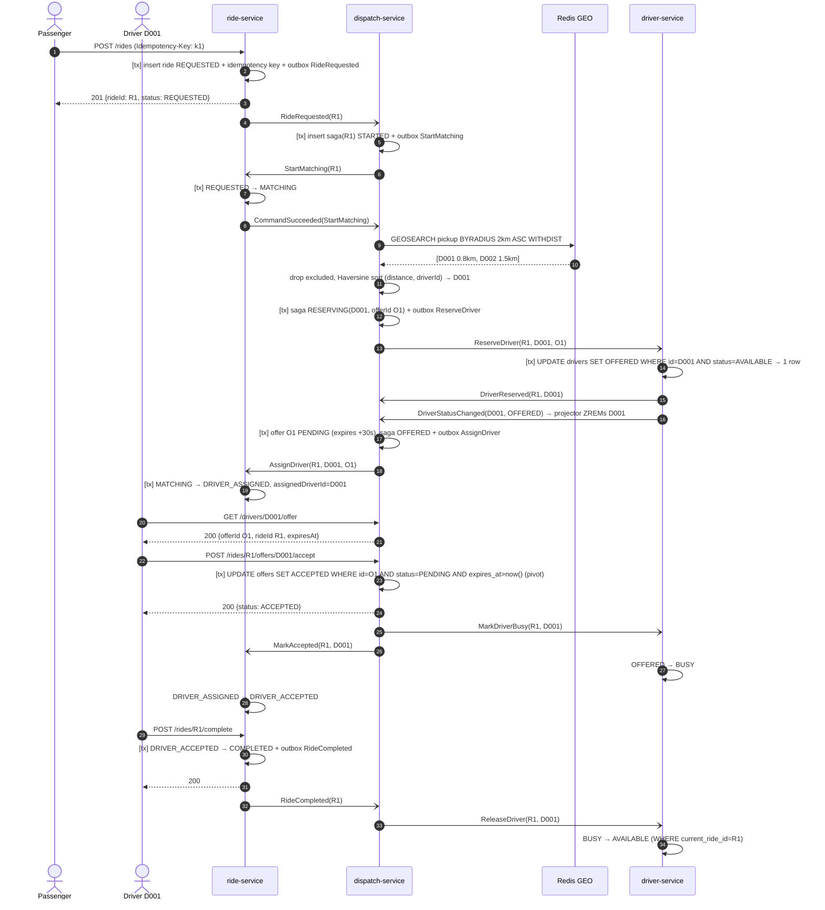
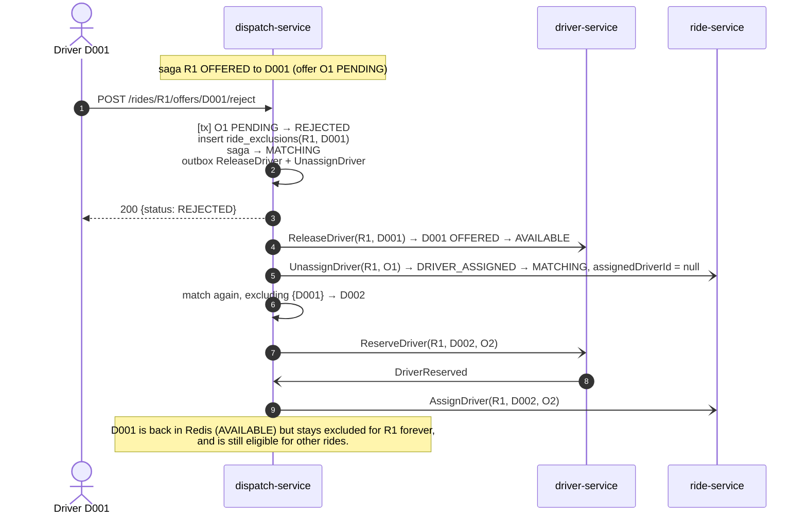
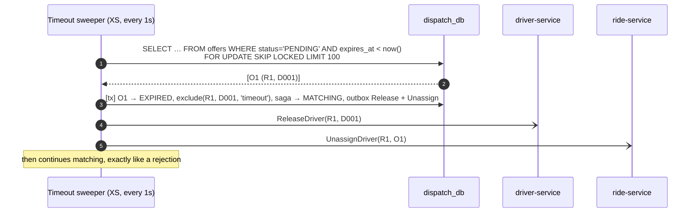
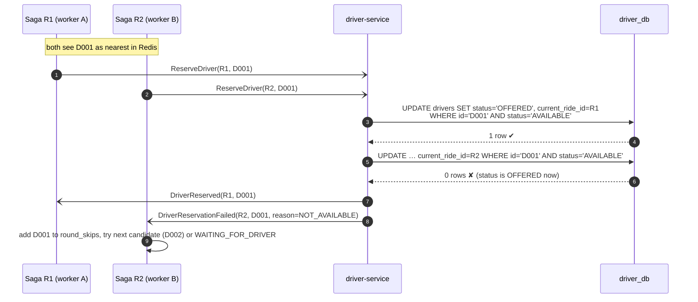
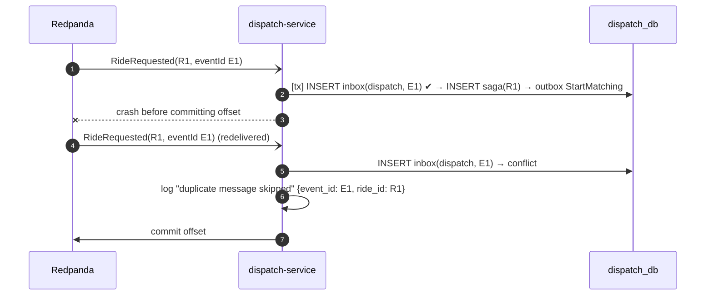
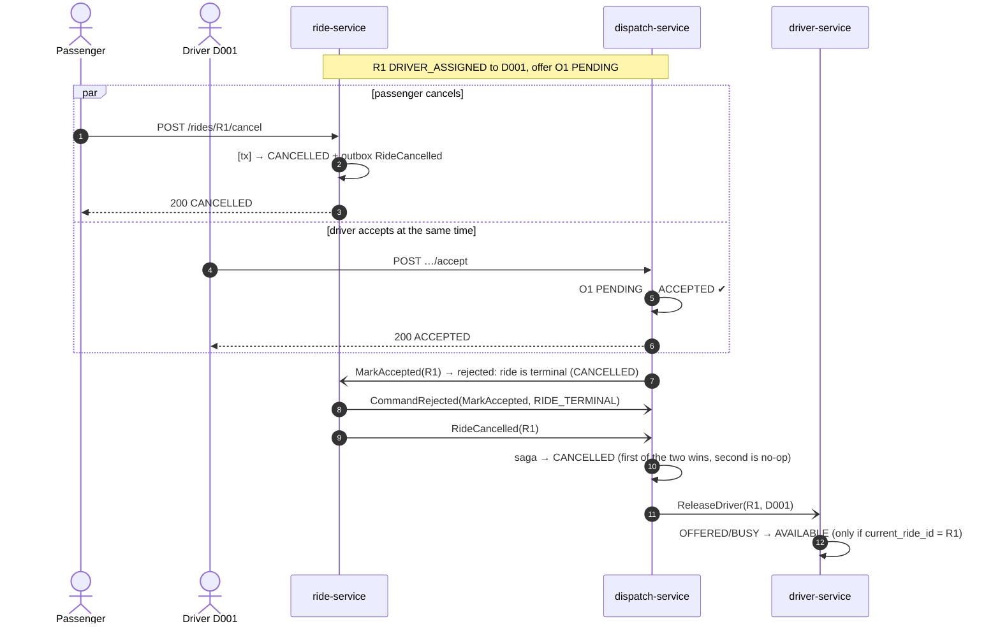

# Sequence Diagrams

All arrows between services go through Redpanda via each service's **outbox**. Diagrams draw them as direct messages to keep them readable. `[tx]` means "in one Postgres transaction, together with the inbox and outbox rows".

Services: **RS** = ride-service, **DS** = driver-service, **XS** = dispatch-service (saga orchestrator).

---

## 1. Happy path: request → offer → accept → complete

---

## 2. Reject → rematch (AC-05, AC-07)

Because `UnassignDriver(O1)` and `AssignDriver(O2)` are both keyed by `R1`, ride-service always applies them in order.

If no eligible candidate remains, the saga goes to `WAITING_FOR_DRIVER`. The ride stays `MATCHING` with `assignedDriverId = null`, and the saga retries every `DISPATCH_RETRY_INTERVAL` (10 s).

---

## 3. Offer timeout (AC-05, AC-06)

`SKIP LOCKED` lets several dispatch replicas sweep without processing the same offer twice.

---

## 4. Concurrency: two rides race for the same driver (AC-09)

The result is the same if the two updates run in parallel on different connections: Postgres row locking makes the second one wait, re-check the `WHERE` clause and update 0 rows.

---

## 5. Duplicate delivery (AC-08, AC-10)

Even with a *different* `eventId` (for example, the producer re-sent after a lost ack), the second `INSERT saga(R1)` hits the primary key. No second saga is created.

---

## 6. Cancel races (AC-05, AC-06)

The ride decides cancellation (it owns the lifecycle). Whatever order the messages arrive in, the end state is the same: ride `CANCELLED`, driver `AVAILABLE`, saga `CANCELLED`. `ReleaseDriver` comes after `MarkDriverBusy` on the same `driverId` partition, so the driver cannot end up stuck in `BUSY`.
